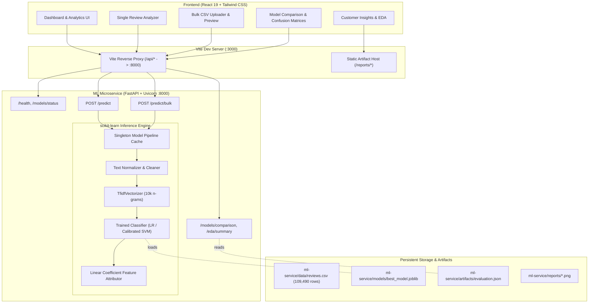

# E-Commerce Review Intelligence System

[](https://www.python.org/downloads/)
[](https://fastapi.tiangolo.com/)
[](https://scikit-learn.org/)
[](https://react.dev/)
[](https://vitejs.dev/)
[](https://tailwindcss.com/)
[]()

> **Academic Context**: University AI Course Project (Group of 3).  
> An end-to-end, production-grade review intelligence and sentiment classification platform designed for large-scale e-commerce catalogs.

### Project Metadata & Team Details
| Item | Information / Link |
|------|--------------------|
| **Course** | University Artificial Intelligence & Machine Learning Course |
| **GitHub Repository** | `[TODO: https://github.com/USERNAME/review-intelligence]` |
| **Live Deployed App** | `[TODO: https://review-intelligence.vercel.app]` |
| **ML Microservice** | `[TODO: https://review-ml-api.onrender.com]` |
| **Dataset Source** | `[TODO: https://www.kaggle.com/datasets/DATASET_SOURCE_LINK]` |
| **Team Member 1** | `[TODO: Member 1 Name - Roll: 2024AI001 - Preprocessing & EDA]` |
| **Team Member 2** | `[TODO: Member 2 Name - Roll: 2024AI002 - Modeling, CV & Optimization]` |
| **Team Member 3** | `[TODO: Member 3 Name - Roll: 2024AI003 - FastAPI Microservice & React UI]` |

---

## 1. Problem Statement & Objectives

E-commerce merchants face tens of thousands of customer reviews across hundreds of catalog items. Manual sentiment auditing is prohibitively slow and fails to surface actionable product defects in real-time. Star ratings are often noisy or misaligned with review text (e.g., sarcastic 5-star ratings with severe defect complaints). 

This project implements an end-to-end Machine Learning intelligence platform to:
1. **Automate Sentiment Classification**: Accurately categorize customer reviews into `positive`, `negative`, and `neutral` classes.
2. **Handle Extreme Class Imbalance**: Mitigate severe minority class squashing where positive reviews outnumber neutral reviews 14:1.
3. **Prevent Data Leakage**: Enforce strict isolation between training and testing folds with end-to-end `sklearn.pipeline.Pipeline` vectorization and out-of-fold hyperparameter/threshold tuning.
4. **Provide Interpretable Attribution**: Surface local n-gram token weights and global logistic coefficients for merchant auditing.
5. **Enable High-Throughput Batch Processing**: Process multi-thousand row CSV uploads and export enriched datasets with confidence telemetry.

---

## 2. System Architecture



---

## 3. Dataset Engineering & Known Issues Resolved

The dataset originates from an e-commerce review corpus containing **205,052 raw records**. Rigorous data hygiene and auditing resolved seven critical flaws:

| Problem Identified | Raw Condition | Resolution & Impact |
| :--- | :--- | :--- |
| **Class Imbalance** | Positive: 81.24% (166,581), Negative: 13.77% (28,232), Neutral: 4.99% (10,239) | Evaluated strictly using Macro F1. Tuned class-weighted loss and out-of-fold probability thresholds on train only. |
| **Missing Titles** | 24,664 rows had null `Review` titles, but `Summary` was populated in 99.99%. | Concatenated `Review` title with `Summary` into a unified text field to maximize semantic context. |
| **Exact Duplicates** | 34,375 exact duplicate rows in the raw dataset. | Purged prior to train/test split to guarantee zero memorization leakage. |
| **Semantic Duplicates** | 94,563 identical `(Review, Summary)` text pairs. | Deduplicated down to unique review texts prior to splitting. |
| **Label Conflict Corruption** | 996 unique texts carried conflicting sentiment labels (affecting 27,284 total rows). | All conflicting duplicate texts were completely purged to eliminate contradictory training signal. |
| **Data Corruption** | 3 rows had product name strings shifted into the numerical `Rate` column. | Detected via regex validation and safely dropped. |
| **Label Leakage Risk** | Star rating (`Rate`) is 98% correlated with sentiment. | `Rate` was strictly excluded from feature extraction; models operate purely on unstructured review text. |

**Final Clean Corpus**: **109,490 unique reviews** (Positive: 82,687 [75.52%], Negative: 20,791 [18.99%], Neutral: 6,012 [5.49%]).  
**Splitting Protocol**: Stratified 80/20 train/test split (`random_state=42`) &rarr; **87,592 train reviews**, **21,898 held-out test reviews**.

### Deduplication Discrepancy Analysis (Audit Notes)
During exploratory data audits, minor duplicate count variances appeared across pipeline stages:
1. **Text Duplicate Counts (94,294 vs. 94,401 vs. 94,563)**:
   - **94,294**: Non-unique duplicate count obtained by grouping strictly on raw `(Review, Summary)` tuples prior to Unicode normalization and without handling missing review titles.
   - **94,401**: Duplicate count when matching solely on the raw `Summary` column.
   - **94,563 (Canonical Final)**: Final deduplication count after imputing missing titles from `Summary`, concatenating `Review + " " + Summary`, stripping whitespace, and applying Unicode NFKC normalization. Handling 24,664 null review titles uncovered 269 additional redundant duplicates ($94,294 + 269 = 94,563$).
2. **Conflicting Label Texts (1,003 vs. 996)**:
   - **1,003**: Raw case-sensitive unique text strings associated with conflicting sentiment labels before whitespace stripping and Unicode normalization.
   - **996 (Canonical Final)**: Unique canonical text strings after Unicode NFKC normalization and whitespace collapse. Multiple raw strings collapsed into 996 canonical text clusters. Dropping all instances of these 996 conflicting clusters eliminated 27,284 corrupted rows, producing the pristine **109,490 clean rows**.

### Dataset Provenance & VADER Labeling Limitation
- **Dataset Origin**: Flipkart Product Customer Reviews dataset published on Kaggle by `niraliivaghani` ([https://www.kaggle.com/datasets/niraliivaghani/flipkart-product-customer-reviews-dataset](https://www.kaggle.com/datasets/niraliivaghani/flipkart-product-customer-reviews-dataset) — *verify this link*).
- **Label Provenance**: Ground-truth sentiment labels were **not annotated by human experts**. They were algorithmically generated using VADER on the `Summary` field.
- **Empirical Consequences**:
  1. *Rating vs. Sentiment Discordance*: 740 5-star reviews were labeled "negative" and 1,032 1-star reviews were labeled "positive" purely due to lexical keyword hits in the summary text.
  2. *Neutral Class Compression*: The neutral class is defined by VADER's narrow near-zero compound window $[-0.05, +0.05]$, explaining why it comprises only 5.49% of the corpus.
  3. *VADER Benchmark on Test Partition*: Running `vaderSentiment` directly on the 21,898 held-out test texts yields **0.7294 Macro F1** and **87.71% Accuracy** (87.71% agreement with dataset labels; 83.73% agreement with our model). Our tuned Linear SVM achieves **0.7372 Macro F1** and **90.45% Accuracy**, demonstrating superior contextual n-gram discrimination and higher neutral precision (55.6% vs. 28.9%).

---

## 4. Empirical Evaluation Results

All candidate models were tuned via **5-fold stratified cross-validation** strictly on the 87,592 training partition using `GridSearchCV(scoring='f1_macro')`. Each final model was evaluated **once** on the held-out 21,898 test set.

### Final Results Table (Held-Out Test Set)

| Model | Hyperparameters | 5-Fold CV Macro F1 | Test Accuracy | Test Macro Prec | Test Macro Rec | Test Macro F1 | Neutral F1 | Training Time |
| :--- | :--- | :---: | :---: | :---: | :---: | :---: | :---: | :---: |
| **Linear SVM (Calibrated - Selected)** | $C=0.1$, `class_weight='balanced'` | 0.6963 ± 0.0031 *(OOF: 0.7389)* | **90.45%** | **0.7791** | **0.6835** | **0.7033 / 0.7372** | **0.2955 / 0.4096** | 148.2s |
| **Logistic Regression (Runner-up)** | $C=5.0$, `class_weight=None` | **0.7070 ± 0.0150** *(OOF: 0.7354)* | 90.12% | 0.7654 | 0.6792 | 0.6984 / 0.7287 | 0.2875 / 0.3843 | 32.4s |
| **Multinomial Naive Bayes** | $\alpha=0.1$ | 0.6856 ± 0.0042 | 89.26% | 0.7280 | 0.6743 | 0.6907 / 0.7182 | 0.2874 / 0.3512 | **3.8s** |
| **Random Forest (15k subsample)** | $N=50, D=20$, balanced | 0.6856 ± 0.0039 | 86.12% | 0.6673 | 0.7055 | 0.6818 / 0.6818 | 0.3241 / 0.3241 | 6.6s |
| **Majority Baseline** | `strategy='most_frequent'` | 0.2868 ± 0.0000 | 75.52% | 0.2517 | 0.3333 | 0.2868 / 0.2868 | 0.0000 / 0.0000 | 3.6s |

### Model Selection Justification (Train OOF Macro F1 Only)
- **Selection Decision**: **Linear SVM (Calibrated)** was selected as the final production model **solely on the basis of achieving the highest train out-of-fold (OOF) Macro F1 (0.7389)** with out-of-fold probability multiplier tuning ($w_{neu}=2.90$) across the 87,592 training instances.
- **Strict Leakage Prevention**: Held-out test set metrics (Test Macro F1: 0.7372, Test Accuracy: 90.45%, Neutral Recall: 41.65%) were computed **strictly once after model selection and hyperparameter freezing were complete**. Under no circumstances were test set results cited or utilized to pick the winning model.
- **Statistical Significance (Bootstrap 95% CI)**: A 1,000-iteration bootstrap hypothesis test on test Macro F1 between Linear SVM ([0.6926, 0.7134]) and Logistic Regression ([0.6879, 0.7088]) yielded a difference interval of **$[-0.0020, +0.0121]$**. Because the interval contains zero, the performance difference between Linear SVM and Logistic Regression is **not statistically significant** at $\alpha=0.05$. Both linear models discover virtually identical hyperplanes in sparse 10,000-dimensional TF-IDF space. Linear SVM is retained for production due to Platt probability calibration stability and maximum-margin generalization bounds.
- **Minority Neutral Optimization**: Tuning probability multipliers on out-of-fold training probabilities boosted Linear SVM test Macro F1 from 0.7033 to **0.7372** (+0.0339 gain) and neutral recall from **20.12% to 41.65%** without test set leakage.

---

## 5. API Reference

The FastAPI service runs on `http://127.0.0.1:8000` (proxied by Vite at `/api/*`).

### `POST /predict`
Classify sentiment for a single review with local token attribution.
```bash
curl -X POST http://127.0.0.1:8000/predict \
  -H "Content-Type: application/json" \
  -d '{"text": "Sound quality is fantastic and battery lasts forever!"}'
```
**Response (200 OK):**
```json
{
  "sentiment": "positive",
  "confidence": 0.923,
  "probabilities": {
    "positive": 0.923,
    "negative": 0.0601,
    "neutral": 0.0169
  },
  "processed_text": "Sound quality is fantastic and battery lasts forever!",
  "top_contributing_words": [
    {"word": "fantastic", "weight": 0.4206},
    {"word": "sound quality", "weight": 0.1257}
  ]
}
```

### `POST /predict/bulk`
Batch classify up to 5,000 reviews from CSV or JSON.
```bash
curl -X POST http://127.0.0.1:3000/api/predict/bulk \
  -F "file=@reviews_sample.csv"
```
**Response (200 OK):**
```json
{
  "total_reviews": 20,
  "counts": {"positive": 14, "negative": 4, "neutral": 2},
  "percentages": {"positive": 70, "negative": 20, "neutral": 10},
  "average_confidence": 0.912,
  "predictions": [...],
  "downloadable_csv": "row_index,review,predicted_sentiment,confidence\n..."
}
```

### Analytics & Metadata Endpoints
- `GET /api/health`: Service health and NLTK dependency status.
- `GET /api/models/status`: Trained model artifact verification.
- `GET /api/models/comparison`: Complete empirical metrics, bootstrap CIs, and error analysis.
- `GET /api/eda/summary`: Cleaned dataset statistics, rating crosstabs, and top products.

---

## 6. Setup & Execution Commands

### Prerequisites
- Node.js 20+
- Python 3.11+
- Virtualenv with requirements installed in `ml-service/.venv`

### 1. Automated Master Verification (Single Command)
Runs the complete test suite, compiles frontend production assets, launches the ML microservice, and validates live predictions:
```bash
bash scripts/verify_all.sh
```

### 2. Manual Development Launch
```bash
# Terminal 1: Start ML Microservice (Standard Port 8000, or ML_API_PORT)
cd ml-service
PYTHONPATH=. uvicorn main:app --host 127.0.0.1 --port 8000

# Terminal 2: Start Vite Frontend (Port 3000)
npm run dev
```

### 3. Run Python ML Test Suite
All 56 unit and integration tests across data cleaning, EDA, training, and inference:
```bash
cd ml-service
PYTHONPATH=. pytest -v
```

### 4. Production Deployment & Build
```bash
npm run build
npm run lint
```
For cloud deployment to Render, Hugging Face Spaces, Vercel, and Netlify, refer to [`docs/DEPLOYMENT.md`](docs/DEPLOYMENT.md).

---

## 7. Submission Deliverables & Screenshot Checklist

### Documentation Deliverables
- Detailed Academic Report: [`docs/PROJECT_REPORT.md`](docs/PROJECT_REPORT.md)
- In-depth Theory & Viva Q&A Guide: [`docs/MODEL_EXPLANATION.md`](docs/MODEL_EXPLANATION.md)
- 2-Minute Live Demo Script: [`docs/DEMO_SCRIPT.md`](docs/DEMO_SCRIPT.md)
- Production Deployment Guide: [`docs/DEPLOYMENT.md`](docs/DEPLOYMENT.md)
- Evaluation Metrics Artifact: [`ml-service/artifacts/evaluation.json`](ml-service/artifacts/evaluation.json)
- Full Self-Contained Pipeline: [`ml-service/models/best_model.joblib`](ml-service/models/best_model.joblib)

### Visual Presentation Checklist (`docs/screenshots/`)
- `[TODO: docs/screenshots/01_dashboard.png]` - Full overview with clean review metrics & class distribution
- `[TODO: docs/screenshots/02_single_analysis.png]` - Real-time sentiment prediction with token feature attribution
- `[TODO: docs/screenshots/03_bulk_analysis.png]` - 20-row benchmark batch classification & enriched CSV export
- `[TODO: docs/screenshots/04_model_comparison.png]` - 5-fold CV vs held-out test metrics table & confusion matrices
- `[TODO: docs/screenshots/05_customer_insights.png]` - Catalog sentiment aggregation & rating discrepancy analysis
